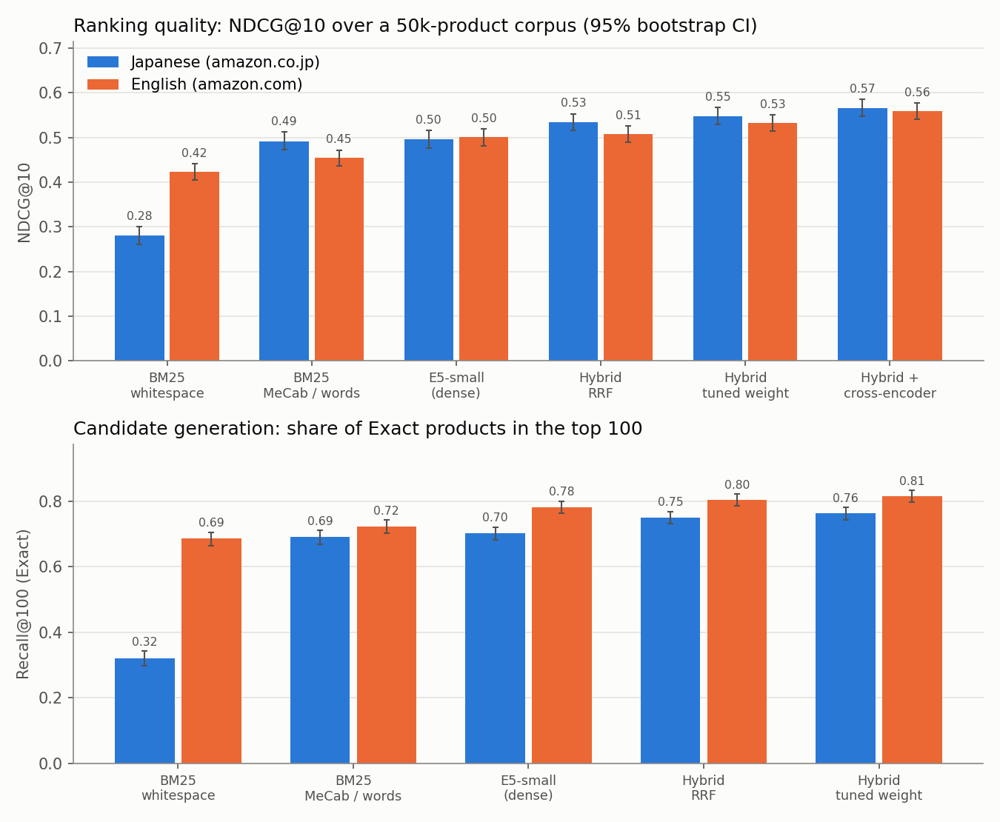
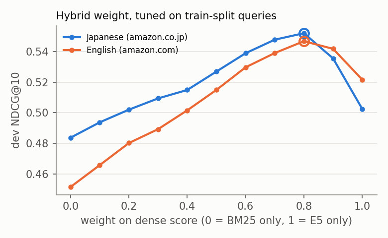
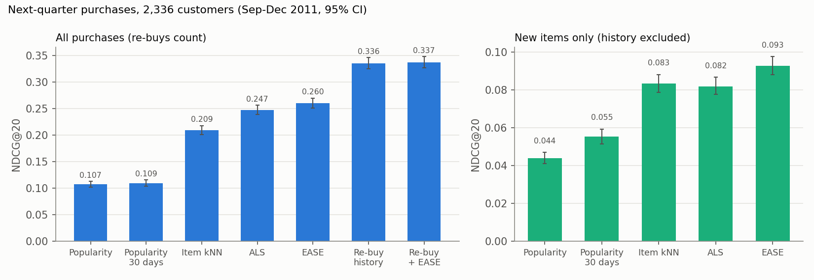
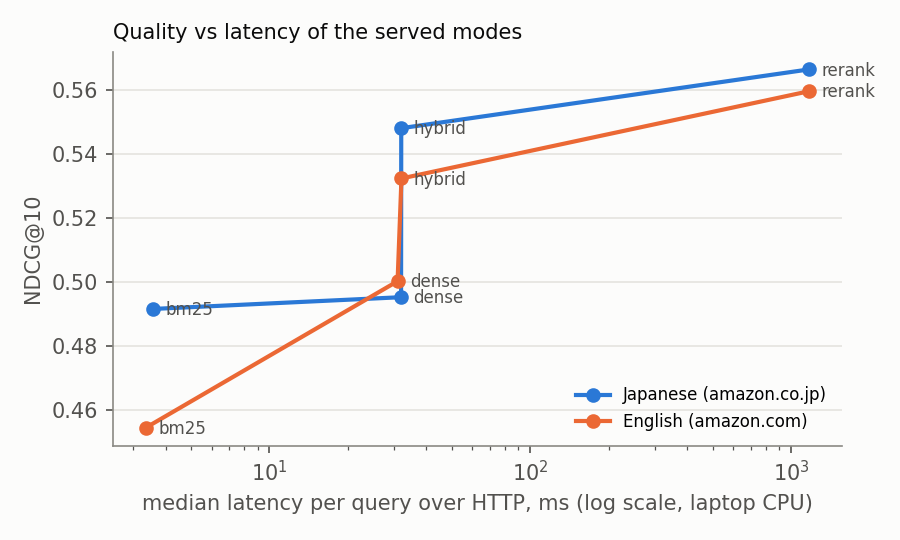

# Bilingual product search and recommendation

[](https://github.com/Praruj/bilingual-product-search/actions/workflows/ci.yml)


[](LICENSE)

Product search for **Japanese and English** shoppers on Amazon's public Shopping Queries dataset (ESCI),
plus next-purchase recommendation on real e-commerce transactions, served by a small FastAPI app on a
laptop CPU. Each number is measured on held-out data and comes with a 95% bootstrap confidence interval.

| Search, NDCG@10 on 1,000 held-out queries | Japanese (amazon.co.jp) | English (amazon.com) |
|---|---|---|
| BM25, naive whitespace tokens | 0.280 | 0.422 |
| BM25, proper tokenizer (MeCab / words) | 0.492 | 0.455 |
| Multilingual E5-small (dense) | 0.495 | 0.500 |
| **Hybrid** (BM25 + E5, weight tuned on train queries) | **0.548** | **0.532** |
| Hybrid + cross-encoder rerank of top 20 | 0.567 | 0.560 |
| Recall@100 of Exact products, hybrid | 0.762 | 0.815 |
| *After fine-tuning both models on ESCI train queries:* | | |
| Hybrid, fine-tuned E5 | 0.582 | 0.559 |
| **Hybrid + fine-tuned reranker** | **0.595** | **0.576** |

| Recommendation, NDCG@20 on next-quarter purchases (2,336 customers) | |
|---|---|
| Popularity | 0.107 |
| EASE (best learned model) | 0.260 |
| **Re-recommend the customer's own past purchases** | **0.336** |



## What I found

**1. For Japanese, tokenization matters more than the choice of model.** Japanese is written without spaces,
so an English-style analyzer treats a whole query like `ステンレス水筒` as one token. Splitting words with
MeCab raises BM25 from 0.280 to 0.492 NDCG@10, a bigger jump than any model change after it.
Dictionary-free character bigrams score the same as MeCab (0.492) but give a 2.6× larger index (57 MB vs
22 MB for 50k products).

**2. Dense and sparse retrieval fail on different queries, so combining them is the biggest model win.**
On Japanese, BM25 (0.492) and E5 (0.495) are statistically tied, yet the hybrid reaches 0.548 (+0.053,
p < 0.001, paired bootstrap). On English, E5 clearly beats BM25 (0.500 vs 0.455) and the hybrid still adds
+0.032 (p < 0.001). A tuned weighted sum beat parameter-free reciprocal rank fusion in both languages
(0.548 vs 0.534; 0.532 vs 0.507, where RRF is not significantly better than E5 alone). The weight was
chosen on separate train-split queries, never on the test queries.



**3. 7% of "Japanese" queries contain no Japanese at all, and the dense model is weaker on them.** Model
numbers, brands and English words (for example `ubuntu`) make up 7.2% of the amazon.co.jp test queries. On
those 72 queries E5 scores 0.402 against BM25's 0.469, which fits the idea that exact string matching helps
with part numbers. The hybrid covers both (0.504). With only 72 queries this gap is suggestive, not proven.

**4. An off-the-shelf cross-encoder is not a free upgrade.** Reranking the hybrid top 20 adds +0.019
(Japanese) and +0.028 (English) NDCG@10, but costs about 1.2 s per query on this CPU. When it only
reorders the judged candidates of each query (the official ESCI ranking task), it does **no better than E5
alone** (Japanese 0.736 vs 0.737; English 0.728 vs 0.742). The model was trained on MS MARCO web passages, not
product listings. Fine-tuning fixes this (finding 5).

**5. Fine-tuning on ESCI's own labels gives the largest gain after the hybrid.** Trained on a Colab T4
(about 40 minutes for both models), the fine-tuned E5 gains +0.065 (Japanese) and +0.041 (English) NDCG@10 on
the full corpus. The fine-tuned cross-encoder now beats E5 on the judged candidates (0.774 vs 0.755; 0.771 vs
0.761), where before it was no better. End to end, hybrid + rerank goes from 0.567 to 0.595 (Japanese) and
0.560 to 0.576 (English), all p ≤ 0.002 on the same test queries. The biggest jump is on the Latin-only
Japanese queries from finding 3, where E5 rises from 0.402 to 0.541. Details and checks are in
[Fine-tuning on ESCI](#fine-tuning-on-esci).

**6. An open LLM judge is not a free replacement for human labels.** Qwen2.5-7B (4-bit, free Colab T4) labelling
ESCI pairs agrees with the human labels at Cohen's κ 0.16–0.21, no better than always guessing the most common
label, and as a ranker it only ties off-the-shelf E5. A cross-encoder trained on 40k LLM-labelled pairs is worse
than the same model trained on the human labels of the same pairs (English end to end 0.545 vs 0.557,
p < 0.001). Part of the disagreement is ESCI's own label noise. Details in
[Can an open LLM replace the human labels?](#can-an-open-llm-replace-the-human-labels)

**7. In recommendation, the strongest baseline is "buy it again".** In this retailer's data, 38% of what a
customer buys in the test quarter they had bought before (many customers are wholesalers who re-stock). Simply
re-recommending their own most frequent items scores 0.336 NDCG@20, well above EASE (0.260), ALS (0.247) and
item-kNN (0.209). Blending EASE into it (0.337) is not a significant gain (p = 0.17). The learned models only
earn their place on **new** items, where EASE beats 30-day popularity by 1.7× (0.093 vs 0.055).



## Serving

`uvicorn bps.service:app --app-dir src` serves both catalogues and the recommender:

```
GET /search?q=ワイヤレスイヤホン&mode=hybrid      # locale auto-detected from the script; mode = bm25 | dense | hybrid | rerank
GET /search?q=water+bottle&locale=us&k=10
GET /recommend/12347?k=10&new_only=true         # unknown customers fall back to best sellers
```

Measured over real HTTP with uvicorn on the same laptop (Intel Core, 7th gen, 2 PyTorch threads), 200 held-out
queries per language sent one at a time:

| Mode | Median latency (p95) | NDCG@10 JA / EN |
|---|---|---|
| BM25 | 3.5 ms (4.7 ms) | 0.492 / 0.455 |
| Dense E5 | 32 ms (43 ms) | 0.495 / 0.500 |
| **Hybrid** | **32 ms (40 ms)** | **0.548 / 0.532** |
| Hybrid + rerank top 20 | 1,171 ms (1,243 ms) | 0.567 / 0.560 |
| Recommendation (EASE) | 3.3 ms (4.5 ms) | |

Almost all of the dense and hybrid time is encoding the query with E5 (BM25 and the 50k × 384 dot product
take under 2 ms), so the hybrid costs nothing over dense alone. On disk, each language's index is 50 MB
(E5 vectors in float16 38 MB, BM25 matrix 9–12 MB) plus the product text; the server holds both catalogues,
both neural models and the recommender in 1.6 GB of RAM. The reranker is the one mode too slow for
interactive search on this CPU. A GPU, a smaller or distilled reranker, or reranking fewer candidates would
be needed to use it in production.



## How it works

**Data.** [Shopping Queries Dataset](https://github.com/amazon-science/esci-data) (Reddy et al., 2022,
Apache 2.0): real Amazon queries with products labelled Exact, Substitute, Complement or Irrelevant. For each
locale, 1,000 test queries are sampled from the official test split and 300 dev queries from the train split
(seeded). The corpus is every product judged for those queries plus distractors (products judged for *other*
queries in the same locale) up to 50,000 products. Product text is title, brand, colour and the first 300
characters of the bullet points.

**Metrics.** NDCG@10 with the ESCI gains used in KDD Cup 2022 (E = 1, S = 0.1, C = 0.01, I = 0) and
recall@100 of Exact products. 95% intervals resample queries (2,000 bootstrap draws); p-values are paired
bootstraps on the same queries.

**Retrieval.**
- BM25 (k1 = 1.2, b = 0.75) written as one sparse matrix product, under 1 ms per query for 50k products.
  Text is NFKC-normalised first, so full-width `ＵＳＢ` matches `usb`. Japanese uses MeCab with UniDic-lite
  (`fugashi`).
- Dense: `intfloat/multilingual-e5-small` (118M parameters, 384-dim), documents truncated to 64 tokens,
  exact inner-product search over all vectors. No ANN index is needed at this size.
- Hybrid: `α · dense + (1 − α) · BM25` on min-max normalised scores, α picked on dev queries (0.8 for both
  languages; the high weight partly reflects that min-max over the whole corpus squeezes cosine scores into a
  narrow band). RRF (k = 60) is reported for comparison.
- Rerank: `cross-encoder/mmarco-mMiniLMv2-L12-H384-v1` (multilingual, MS MARCO) on the hybrid top 20.

**Recommendation.** [Online Retail II](https://archive.ics.uci.edu/dataset/502/online+retail+ii) (UCI,
CC BY 4.0): 803k purchase lines from a UK online gift retailer, Dec 2009 to Dec 2011, after removing
cancellations, guest checkouts and non-product codes (postage, fees). Time-based split: hyperparameters are
tuned on June–August 2011 with training data before June, then models are retrained on everything before
September and tested on September to December 9, 2011, for customers who bought in both periods.
Recall@20 is normalised by min(|bought|, 20). Models: popularity (all time and last 30 days), own-history
re-buy, item-kNN cosine, implicit ALS (Hu et al., 2008; exact solves, written in NumPy), and EASE (Steck, 2019).

## Fine-tuning on ESCI

Both neural models were fine-tuned on ESCI training queries and evaluated with the unchanged pipeline on the
same 1,000 test queries per language and the same 50k-product corpora as everything above.

**Training data.** `scripts/make_finetune_data.py` takes ESCI `small_version` train-split queries for jp and
us and removes the 300 dev queries per language that the hybrid weight is tuned on, leaving 27,572 queries and
614,450 judged (query, product) pairs. It asserts that no training query is an evaluation query and that no
training query has the same text as any test-split query. Product text is the same as in the evaluation corpus.

**Models** ([notebooks/colab_finetune.ipynb](notebooks/colab_finetune.ipynb), one T4 GPU: 10 min for E5, 27 min
for the reranker; hyperparameters fixed before seeing any test result, single run, seed 0):
- E5-small: contrastive loss over in-batch negatives plus one hard negative per query, taken from that query's
  products labelled Irrelevant or Substitute; batches hold one language and each query at most once, so a
  query's other Exact products are never treated as negatives. 2 epochs, up to 4 Exact products per query per
  epoch, batch 128, learning rate 3e-5.
- Cross-encoder: binary cross-entropy on every judged pair with the ESCI gains as soft targets
  (E 1, S 0.1, C 0.01, I 0), 1 epoch, batch 64, learning rate 2e-5.

**Results** (`scripts/compare_runs.py --new finetuned`; paired bootstrap over the same queries; the
judged-candidate cross-encoder rows use the first 200 test queries, as in the baseline):

| | NDCG@10 | Off-the-shelf [95% CI] | Fine-tuned [95% CI] | Δ [95% CI] | p |
|---|---|---|---|---|---|
| JA | E5, full corpus | 0.495 [0.476, 0.516] | 0.560 [0.541, 0.579] | +0.065 [+0.054, +0.077] | < 0.001 |
| JA | Hybrid, full corpus | 0.548 [0.529, 0.567] | 0.582 [0.564, 0.602] | +0.034 [+0.025, +0.042] | < 0.001 |
| JA | Hybrid + rerank top 20 | 0.567 [0.548, 0.586] | 0.595 [0.577, 0.614] | +0.029 [+0.020, +0.038] | < 0.001 |
| JA | E5, judged candidates | 0.737 [0.724, 0.751] | 0.755 [0.741, 0.768] | +0.017 [+0.010, +0.025] | < 0.001 |
| JA | Cross-encoder, judged candidates | 0.736 [0.703, 0.764] | 0.774 [0.744, 0.802] | +0.038 [+0.018, +0.059] | 0.002 |
| EN | E5, full corpus | 0.500 [0.481, 0.519] | 0.542 [0.523, 0.561] | +0.041 [+0.031, +0.052] | < 0.001 |
| EN | Hybrid, full corpus | 0.532 [0.515, 0.551] | 0.559 [0.541, 0.577] | +0.027 [+0.019, +0.035] | < 0.001 |
| EN | Hybrid + rerank top 20 | 0.560 [0.541, 0.577] | 0.576 [0.558, 0.593] | +0.016 [+0.005, +0.026] | 0.001 |
| EN | E5, judged candidates | 0.742 [0.731, 0.754] | 0.761 [0.750, 0.774] | +0.019 [+0.012, +0.027] | < 0.001 |
| EN | Cross-encoder, judged candidates | 0.728 [0.698, 0.757] | 0.771 [0.742, 0.799] | +0.043 [+0.024, +0.062] | < 0.001 |

Recall@100 of the hybrid rose from 0.762 to 0.795 (JA) and 0.815 to 0.851 (EN). The hybrid weight re-tuned on
the dev queries stayed at 0.8. On Japanese queries with no Japanese characters (72 queries), fine-tuned E5
scores 0.541 against 0.402 before, so the dense model no longer trails BM25 (0.469) there.

**Checks.**
- *Reproducibility.* Before the comparison the off-the-shelf pipeline was rerun from scratch; every metric
  matched the earlier run exactly, so the deltas are not run-to-run noise in the evaluation.
- *Seen products.* No test query is in the training data, but 24.5% of test-judged products were also judged
  for some training query, so the models have seen their text. The gain does not come from that: on the 435 (JA)
  and 448 (EN) test queries whose Exact products never appear in training, the hybrid gains +0.036 [+0.022,
  +0.049] and +0.032 [+0.020, +0.044], at least as much as on the rest
  (`outputs/finetune/seen_product_check.json`).
- *Sanity check during training.* On 300 held-back training queries per language, NDCG@10 on judged
  candidates rose from 0.737 to 0.754 (JA) / 0.725 to 0.758 (EN) for E5 and from 0.742 to 0.773 / 0.743 to
  0.783 for the reranker (`outputs/finetune/finetune_log.json`). These queries were not used for any choice.

**Cost.** Same architectures, so the same latency (the reranker still needs about 1.3–1.6 s per query for 20
candidates on this CPU, measured while other jobs shared it). The fine-tuned models are not committed (470 MB
each); the notebook rebuilds them. The API in this repo still serves the off-the-shelf models.

## Can an open LLM replace the human labels?

Relevance labels are expensive, so a common idea is to let an LLM judge (query, product) pairs instead. I tested
this at zero cost: an open model on a free Colab T4, no paid API.

**Setup** ([notebooks/colab_llm_judge.ipynb](notebooks/colab_llm_judge.ipynb), `scripts/llm_judge.py`).
`Qwen/Qwen2.5-7B-Instruct` (Apache-2.0), 4-bit NF4. The prompt gives the four ESCI definitions, the query and the
product text (first 400 characters); the next-token probabilities of the letters E / S / C / I are the
judgement (one forward pass, no sampling, no prompt tuning on evaluation pairs). The system prompt's
keys/values are computed once and shared by every batch, which takes the T4 from 5 to about 8–9 pairs per second
(same argmax label on all 609 pairs checked). `scripts/make_judge_data.py` picks the pairs and the notebook
checks that Colab rebuilt exactly the same file (fingerprint):
- *Held-out:* every judged product of the first 200 test queries per language (10,226 pairs), the same
  queries as the judged-candidate rows above.
- *Distillation:* whole training queries (train split minus the dev queries; no test query or test query text,
  asserted), labelled in a seeded random order within a 1.3-hour budget: 1,620 queries (810 per language),
  40,118 pairs.

**1. Agreement with the human labels is weak** (`scripts/judge_report.py` → `outputs/llm_judge/results.md`;
intervals resample whole queries):

| Pairs | Lang | Accuracy [95% CI] | Always the most common label | Cohen's κ [95% CI] | κ, Exact vs rest | Recall E / S / C / I |
|---|---|---|---|---|---|---|
| Held-out (test) | JA | 0.398 [0.364, 0.433] | 0.383 | 0.163 [0.130, 0.197] | 0.252 | 0.66 / 0.02 / 0.05 / 0.75 |
| Held-out (test) | EN | 0.420 [0.392, 0.449] | 0.424 | 0.181 [0.151, 0.210] | 0.251 | 0.54 / 0.11 / 0.03 / 0.83 |
| Training | JA | 0.447 [0.431, 0.464] | 0.460 | 0.191 [0.175, 0.207] | 0.304 | 0.68 / 0.02 / 0.07 / 0.77 |
| Training | EN | 0.448 [0.432, 0.464] | 0.420 | 0.205 [0.188, 0.222] | 0.297 | 0.64 / 0.09 / 0.06 / 0.78 |

Accuracy is no better than always answering the most common label. The model almost never says Substitute,
and it calls about a third of the human-Exact products Irrelevant. The disagreement is not all the model's
fault: in a read of 20 random "human Exact, LLM Irrelevant" pairs, about half of the human labels look wrong
(a 60-inch vanity for "72 inch vanity", a bag with handles for "取っ手なし"); the LLM's own typical miss is a
bare brand or author name (`outputs/llm_judge/audit_exact_vs_irrelevant.md`; one reader, so only a rough
indication).

**2. As a ranker, the LLM ties off-the-shelf E5 and loses to every cross-encoder.** NDCG@10 when each held-out
query's judged products are ordered by the LLM's expected gain, paired on the same 200 queries per language:

| Ranker | JA | EN |
|---|---|---|
| Random order | 0.568 | 0.576 |
| **LLM judge** (Qwen2.5-7B, 4-bit) | **0.686** [0.652, 0.720] | **0.700** [0.672, 0.727] |
| E5, off the shelf | 0.690 (LLM −0.004, p = 0.83) | 0.711 (LLM −0.011, p = 0.45) |
| Cross-encoder, off the shelf | 0.736 (LLM −0.049, p = 0.001) | 0.728 (LLM −0.028, p = 0.030) |
| Cross-encoder fine-tuned on 600k human labels | 0.774 (LLM −0.088, p < 0.001) | 0.771 (LLM −0.071, p < 0.001) |

**3. Distillation: a cross-encoder trained on LLM labels does not come close to one trained on human labels.**
The same cross-encoder recipe as above (1 epoch, BCE on ESCI gains) was trained twice on exactly the same
40,118 pairs, once with the gain of the LLM's label and once with the human label, and evaluated with
`run_search.py` on the full test set (`compare_runs.py`; paired bootstrap):

| | Lang | Off the shelf | Human labels (same pairs) | LLM labels | LLM − human [95% CI], p |
|---|---|---|---|---|---|
| Cross-encoder, judged candidates (200 q) | JA | 0.736 | 0.759 | 0.747 | −0.012 [−0.027, +0.002], 0.11 |
| Cross-encoder, judged candidates (200 q) | EN | 0.728 | 0.749 | 0.723 | −0.026 [−0.040, −0.012], < 0.001 |
| Hybrid + rerank top 20 (1,000 q) | JA | 0.567 | 0.575 | 0.569 | −0.006 [−0.012, +0.000], 0.074 |
| Hybrid + rerank top 20 (1,000 q) | EN | 0.560 | 0.557 | 0.545 | −0.012 [−0.019, −0.006], < 0.001 |

Human labels on 40k pairs already help the reranker on judged candidates (+0.024 JA, p = 0.011; +0.020 EN,
p = 0.020 over off the shelf). The same pairs with LLM labels give no significant gain in Japanese and make
English end-to-end search worse than not training at all (0.545 vs 0.560, p < 0.001). One curiosity: the
student beats its teacher (0.747 vs 0.686 JA on judged candidates), because it starts from a pretrained
reranker and only learns the labels' coarse shape.

**Bottom line.** With this model, prompt and free hardware, LLM labels are not a substitute for ESCI's human
labels. They would need at least a stronger judge, few-shot examples, or calibration against a small human-labelled
set. ESCI's own label noise also caps how much agreement is possible. Single run, one prompt, no tuning;
the final run took about 2 hours of free Colab GPU time.

## Limitations

- **Unjudged products count as irrelevant.** ESCI only labels about 28 products per query, so a relevant
  product that no annotator saw scores zero. This penalises every method, probably dense retrieval more
  since it finds products with no word overlap. Absolute numbers are lower bounds; the comparisons are the
  point.
- The corpus is 50k products per locale, not Amazon's full catalogue, because encoding runs at about 40
  products per second on this laptop (2 threads). A larger corpus makes every method look worse.
- The fine-tuned models come from one fixed set of hyperparameters and a single training run (seed 0);
  run-to-run variance of the fine-tuning itself is not measured. The API and latency numbers use the
  off-the-shelf models.
- The latency is one laptop, one request at a time. Throughput under concurrency is not measured.
- Online Retail II is one UK retailer with many wholesale buyers, so "buy it again" is unusually strong.
  On a marketplace like Rakuten Ichiba, the balance between re-buys and discovery will be different.
- No cross-lingual evaluation: Japanese queries are only scored against the Japanese catalogue, because
  ESCI has no labels for English queries on Japanese products.

## Reproduce

```bash
python -m venv .venv && .venv/Scripts/activate           # Windows; use bin/activate elsewhere
pip install torch==2.5.1 --index-url https://download.pytorch.org/whl/cpu
pip install -r requirements.txt

# data (not in the repo)
#   ESCI (Apache 2.0), into data/raw/esci/:
#     https://github.com/amazon-science/esci-data/tree/main/shopping_queries_dataset
#     shopping_queries_dataset_examples.parquet (51 MB), shopping_queries_dataset_products.parquet (1.1 GB)
#   Online Retail II (CC BY 4.0), into data/raw/online_retail/:
#     https://archive.ics.uci.edu/static/public/502/online+retail+ii.zip (46 MB)

python scripts/run_recs.py        # ~6 min
python scripts/run_search.py      # ~2 h on a 2-core laptop CPU, mostly encoding and reranking
python scripts/build_index.py     # artifacts for the API in outputs/index/
python scripts/bench_service.py   # starts the API and measures latency
python scripts/report.py          # figures in outputs/figures

# optional: fine-tuning (training on a Colab GPU, evaluation on the laptop)
python scripts/make_finetune_data.py   # data/finetune/esci_train_pairs.parquet -> upload to MyDrive/bps/
#   run notebooks/colab_finetune.ipynb on Colab, download MyDrive/bps/models/ into models/
python scripts/run_search.py --encoder models/e5-small-esci --reranker models/mmarco-minilm-esci --tag finetuned
python scripts/compare_runs.py --new finetuned
# optional: LLM relevance judge (labelling and training on free Colab, evaluation on the laptop)
python scripts/make_judge_data.py      # data/judge/judge_pairs.parquet (the notebook rebuilds and checks it)
#   run notebooks/colab_llm_judge.ipynb on Colab; unzip labels/ into data/judge/, models/ into models/llm_judge/
python scripts/judge_report.py         # agreement and LLM ranking -> outputs/llm_judge/
python scripts/run_search.py --reranker models/llm_judge/mmarco-minilm-llm-labels --tag llm_distilled
python scripts/run_search.py --reranker models/llm_judge/mmarco-minilm-human-labels --tag human_subset
python scripts/compare_runs.py --base human_subset --new llm_distilled
pytest -q                         # 28 tests on synthetic data, no downloads
```

## 日本語概要

Amazonの公開データセット「Shopping Queries（ESCI）」を使った日本語・英語の商品検索と、実際のEC購買データによる
レコメンドのプロジェクトです。FastAPIでノートPCのCPU上で動かし、すべての指標を未使用のテストデータで評価しています。

- **検索**（NDCG@10、各言語1,000クエリ）：日本語は空白区切りのBM25が0.280、MeCabで形態素解析すると0.492、
  多言語E5が0.495、両者のハイブリッドが**0.548**。英語はBM25 0.455、E5 0.500、ハイブリッド**0.532**。
  ESCIの学習データで両モデルをファインチューニングすると、ハイブリッド＋再ランキングで日本語**0.595**、英語**0.576**。
- **レコメンド**（NDCG@20、2,336人の次の四半期の購買）：人気順0.107、EASE 0.260、
  **過去に買った商品の再推薦0.336**。

主な発見：
1. 日本語検索では、モデルの選択よりも単語分割（トークナイズ）の方が効果が大きい。
2. BM25とベクトル検索は苦手なクエリが異なるため、組み合わせると統計的に有意に改善する（重みは学習用クエリで調整）。
3. amazon.co.jpのクエリの約7%は型番や英単語のみで、そこではベクトル検索がBM25に負ける。
4. 既製のクロスエンコーダによる再ランキングは1クエリ約1.2秒かかり、ESCIの公式設定ではE5単体と同等。
5. ESCIの学習用クエリ（評価用クエリは除外）でファインチューニングすると、E5は日本語+0.065、英語+0.041改善し、
   クロスエンコーダもE5を上回るようになった（Colab T4で約40分、すべてp ≤ 0.002）。
6. オープンLLM（Qwen2.5-7B、無料のColab T4）にESCIの関連度ラベルを付けさせると、人手ラベルとの一致はκ 0.16〜0.21と低く、
   ランキング性能も既製E5と同等。LLMラベルで学習したクロスエンコーダは、同じペアの人手ラベルで学習したものより弱い
   （英語の検索全体で0.545対0.557、p < 0.001）。ただし不一致の一部はESCI側のラベルの誤りによる。
7. レコメンドでは「同じ商品をまた買う」が最強のベースライン。学習モデルが勝つのは新しい商品の推薦のみ（EASEは人気順の1.7倍）。

## License

Code: MIT. Data is not redistributed: ESCI is Apache 2.0 (Amazon), Online Retail II is CC BY 4.0 (Chen, 2012,
UCI Machine Learning Repository).
